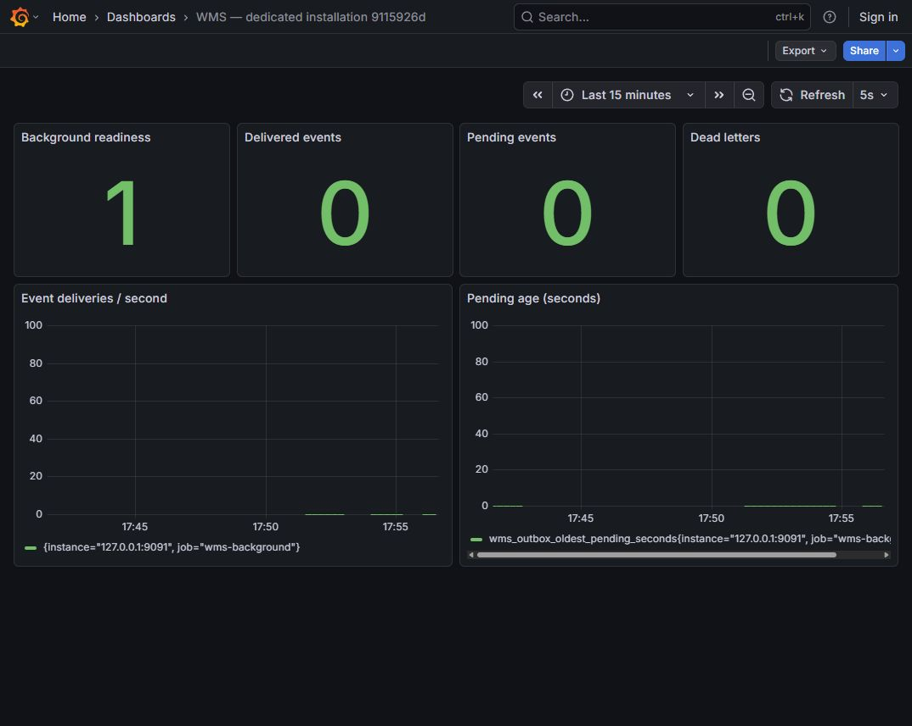

# WMS: стенд Hyper-V

Материалы проверки двух независимых on-premise установок WMS от 28 октября 2026 года. На снимках — настоящие Ubuntu и Grafana с синтетическими данными.

Проверенный релиз: [`89fe54a`](https://github.com/Shpuntyara/wms-platform/commit/89fe54add10e8f3094810fb4da22438ecb5fac5a). [Полный CI этого релиза](https://github.com/Shpuntyara/wms-platform/actions/runs/40729659428).

## Видео

[Запись дашбордов, 36 секунд](wms-two-instances-demo.mp4): три отдельных 12-секундных эпизода — остановка A, работа B, восстановление A. Между эпизодами есть монтажные склейки.

## Скриншоты

| Файл | Содержимое |
| --- | --- |
| [01](01-ubuntu-hyperv-console.jpg) | Консоль загруженной Ubuntu в Hyper-V |
| [02](02-wms-a-live-grafana.jpg) | Первоначальный снимок Grafana установки A |
| [03](03-wms-b-live-grafana.jpg) | Работающая независимая установка B |
| [04](04-wms-a-controlled-outage.jpg) | Контролируемая остановка API A, готовность 0 |
| [05](05-wms-a-recovered.jpg) | Восстановившаяся установка A, готовность 1 |
| [06](06-lab-report-preview.jpg) | Обзор результатов проверки стенда |

Контрольные суммы файлов: [SHA256SUMS](SHA256SUMS).

Обе ВМ размещены на одном физическом ПК; проверка независимости сервисов ограничена этим лабораторным стендом. Бэкапы хранятся локально. Подробности эксплуатации — в [документации установщика](../../deployment-installer.md).
