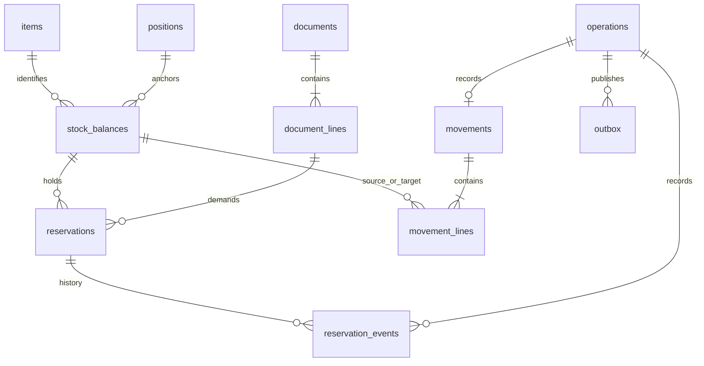

# PostgreSQL ядро WMS

Схема предназначена для отдельной базы на клиента. Начальная проверяемая реализация хранит остатки, резервы и журнал движений, проводит команды одной транзакцией и предоставляет границы для клиентских модулей. Проверено на PostgreSQL 17; совместимость с другими major требует отдельного прогона.

Это основа продукта, а не готовая WMS. Поверх ядра реализован [Go backend](go-backend.md): HTTP API, проверка OIDC access token, права по складам/владельцам и загрузчик обязательных guards. Приёмка с интерфейсом, управление вложениями, фоновый диспетчер и отказоустойчивая инфраструктура ещё не реализованы. Низкоуровневые SQL-команды вызываются доверенным сервером после проверки бизнес-допуска.

## Структура

| Схема | Таблицы | Назначение |
|---|---|---|
| `platform` | `organizations`, `actors`, `actor_grants`, `operations`, `outbox`, `inbox`, `audit_entries`, `modules`, `module_migrations` | Контекст, права доступа, идемпотентность, доставка и расширения |
| `catalog` | `stock_owners`, `units`, `items`, `packagings`, `lots`, `serials` | Номенклатура и прослеживаемость |
| `warehouse` | `warehouses`, `locations`, `handling_units`, `positions`, `documents`, `document_lines` | Топология, основания и исполнение |
| `inventory` | `stock_states`, `stock_balances`, `reservations`, `movements`, `movement_lines`, `reservation_events` | Учёт |
| `contracts_v1` | Представления `stock_balances`, `documents`, `document_lines`, `reservations`, `movements`, `operations`, `actor_grants`, `active_modules` | Опубликованное чтение для приложения и модулей |

Идентификаторы бизнес-объектов — UUID; строки журнала и аудита получают последовательный bigint. Количества — `numeric(24,6)`, до 18 целых и 6 дробных разрядов; точность конкретного товара ограничивает `quantity_scale`. Объёмы и цены в эту схему не добавляются без конкретного сценария.

## Ключ запаса

`organization_id + warehouse_id + owner_id + item_id + position_id + stock_state + lot_id + serial_id`.

`UNIQUE NULLS NOT DISTINCT` не допускает несколько одинаковых строк без партии/серии. Количество и резерв находятся в той же блокируемой строке, что и идентичность запаса. Менять идентичность существующего баланса запрещает триггер: смена места/состояния проводится между двумя балансами.

`position` ссылается либо на ячейку, либо на грузовую единицу. Паллета имеет свою позицию, а её физическая ячейка определяется через `handling_units.location_id`; запас не дублируется на паллете и в ячейке. Вложенные контейнеры и публичная команда перемещения всей паллеты не реализованы в этой итерации. Обновлять расположение паллеты из модуля напрямую запрещено; будущая команда требует отдельной истории размещения и блокировки грузовой единицы.

Составные FK проверяют организацию, склад, владельца и товар; UUID сам по себе не доказывает соответствие контекста. Частичный уникальный индекс `stock_serial_occupancy_uq` разрешает серийному экземпляру иметь положительный остаток только в одной позиции. Нулевые исторические балансы сохраняются.

## Остатки, резервы и исполнение

- `stock_balances.on_hand` — физическое количество.
- `stock_balances.reserved_qty` — суммарный активный резерв этого запаса.
- `reservations.active_qty = quantity - consumed_qty - released_qty`.
- `document_lines.reserved_qty` — активный резерв строки документа по всем позициям.
- `document_lines.fulfilled_qty` — физическое исполнение потребности.
- `document_lines.requested_qty` — разрешённое количество потребности.

Для пригодного состояния `available_qty = on_hand - reserved_qty`. Для карантина/брака опубликованный доступный остаток равен нулю. В v1 невозможно зарезервировать физически отсутствующий товар; backorder остаётся потребностью заказа.

CHECK-ограничения защищают неотрицательность, границы резерва и исполнение относительно потребности. Соответствие сумм по нескольким таблицам обеспечивают закрытые функции записи и общий порядок блокировок; обычный CHECK не проверяет агрегат других строк. `db/queries/reconciliation.sql` выявляет расхождения в едином read-only snapshot. Владелец схемы/администратор остаётся доверенной ролью и способен нарушить данные; журнал не является защитой от суперпользователя.

Частичная приёмка/отгрузка увеличивает исполнение на фактическое количество. Превышение потребности блокируется; разрешённая перепоставка требует явного изменения потребности/правил через будущий бизнес-API. Команды принимают базовую единицу. Перед добавлением API ввода упаковок нужно фиксировать исходную единицу и коэффициент пересчёта в документе; текущие проводки уже сохраняют точное количество в неизменной базовой единице товара.

## Транзакции

Публичные функции ядра в `0002_inventory_commands.sql`:

| Функция | Поведение |
|---|---|
| `ensure_balance` | Создать или получить нулевую идентичность запаса |
| `reserve_stock` | Добавить резерв конкретного запаса под строку отгрузки |
| `release_reservation` | Частично/полностью освободить резерв с причиной |
| `post_movement` | Приёмка, перенос, отгрузка, положительная/отрицательная корректировка |
| `prepare_movement` | Разрешить повтор команды и захватить документ перед guard; требует ту же транзакцию до проведения |
| `warehouse.lock_document` | Получить блокировку и снимок документа для проверки модуля в той же транзакции |
| `platform.get_operation_result` | Прочитать результат с проверкой исходного автора и контекста |

Каждая изменяющая команда выполняется при READ COMMITTED. Порядок: уникальный `command_id`, документ, строка документа, балансы по возрастанию UUID, конкретный резерв. Документ сериализует изменение состава и разрешения проведения; это осознанная граница конкуренции. Массовые операции, затрагивающие несколько документов, должны сортировать документы или выполнять независимые команды; такой batch API пока не реализован.

`expected_document_version` проверяется под блокировкой. Устаревшая версия — бизнес-конфликт, а не повод бесконечно перепроводить команду. Для 40P01/40001 сервер может ограниченно повторить целую транзакцию с тем же ID; для `document_version_conflict` требуется актуализация состояния. Не удерживать транзакцию во время ожидания пользователя/печати/HTTP-вызова. Таймауты блокировок, запросов и idle transaction задаются в профиле подключения.

### Резервирование

1. Зарегистрировать команду или вернуть уже сохранённый результат.
2. Заблокировать документ/строку; проверить версию и состояние.
3. Заблокировать баланс; проверить контекст, пригодность, доступность и единицы.
4. Увеличить агрегированные резервы баланса/строки; создать `reservation` и событие истории.
5. Увеличить версию документа; записать результат, аудит и outbox.
6. Commit. При любой ошибке все изменения отменяются.

### Отбор и перенос

Свободный перенос использует только `on_hand - reserved_qty`. Перенос зарезервированного товара освобождает соответствующую часть исходного резерва и создаёт новый резерв на целевой позиции. Общий резерв строки сохраняется; `fulfilled_qty` не увеличивается. Это предотвращает ложное исполнение заказа при простом перемещении к зоне отгрузки.

Баланс источника уменьшается до увеличения целевого баланса. Поэтому уникальное размещение серийного экземпляра не нарушается внутри переноса. Обе строки заранее блокируются в одинаковом порядке независимо от направления.

### Отгрузка

Отгрузка требует активного неистёкшего резерва. Сначала уменьшается резерв, затем физический остаток; в той же транзакции увеличивается фактическое исполнение. Go backend проверяет право проведения и обязательные клиентские guards под блокировкой документа до вызова SQL-примитива. Дополнительные правила упаковки, сроков и согласований добавляются прикладными модулями через этот же протокол.

### Идемпотентность

`operations.id` — глобально уникальный UUID команды внутри установки. Записывается нормализованный JSONB входа; равенство JSONB учитывает одинаковые числовые значения. Автор, тип, параметры и ожидаемая версия должны совпадать. Конкурентный повтор ждёт завершения первой транзакции на уникальном ключе и возвращает её результат.

Результат проверяется до текущей версии документа, поэтому сетевой повтор завершённой команды работает и после изменения версии/истечения резерва. Деферрированный триггер не разрешает commit незавершённого `operations`. Неуспешная команда откатывается целиком; долговременное хранение бизнес-отказов в этой итерации не реализовано. ID проведённых команд и история не удаляются по TTL. Кэш ответа в API не заменяет этот механизм.

## История и индексы

`movements` — основание, вид операции, связь с командой и возможная ссылка на корректируемое движение; `movement_lines` — положительное количество с источником и/или назначением. Источник отсутствует при приходе, назначение — при выбытии. Корректировка требует причину и отдельный документ; ссылка `correction_of` не означает автоматическое сторнирование и не заменяет согласование.

Проведённые движения, строки, события резервов и аудит запрещено обновлять/удалять обычными операциями. Начальная функция проводит одну строку движения на команду; таблицы допускают много строк, но атомарная многострочная команда требует отдельной реализации и тестов.

Основные индексы:

- Уникальный полный ключ баланса с NULLS NOT DISTINCT.
- Частичный уникальный индекс занятого серийного экземпляра.
- `stock_allocation_idx` по организации/складу/владельцу/товару/состоянию только для положительной доступности.
- Индексы балансов по позиции, владельцу, партии и ссылкам FK.
- Активные резервы по балансу; истечения по `expires_at,id` без `now()` в предикате индекса.
- Журнал отдельно по источнику и назначению с последовательным `movement_lines.id` для курсора.
- Документы, исполнения и движения по основаниям; outbox по времени готовности недоставленных событий.
- `0005`: страницы остатков, резервов и движений по `organization_id,warehouse_id,owner_id,id`. Нагрузочный прогон подтвердил пользу индексов и прямого условия `id > cursor` для prepared plans; optional OR для владельца/курсора в List больше не используется.

Индексы частичной доступности увеличивают стоимость изменения остатков; их ценность проверяется на реальном профиле. Сортировка FEFO через join партии может потребовать отдельной оптимизации при больших объёмах. Партиционирование, Redis и реплика для проверок доступности в эту основу не добавлены. Источник истины для проведения — основной PostgreSQL.

## Клиентские модули

Пример хранения: `db/examples/dispatch_quality_schema.sql`. Модуль имеет собственную схему и append-only решения. Ключ `(organization_id, warehouse_id, document_id)` таблицы `warehouse.documents` объявлен стабильной FK-поверхностью. Для прочих данных используются `contracts_v1`/SDK; новые FK на произвольные внутренние таблицы запрещены контрактом.

Дополнительное согласование записывается в транзакции: `lock_document`, проверка версии/состава, INSERT решения, аудит и увеличение версии документа через будущий прикладной SDK. Проверка перед отгрузкой использует `prepare_movement` и получает ту же блокировку. Ни создание/отзыв согласования, ни изменение содержимого не могут обходить этот порядок. Сам пример DDL не реализует этот SDK и не подключает guard автоматически.

Протокол прикладного обработчика: BEGIN; вызвать `prepare_movement` с точными параметрами будущего движения. Если `replayed=true`, вернуть сохранённый результат без повторной проверки текущего документа. Иначе выполнить все обязательные guards и вызвать `post_movement` с теми же параметрами до COMMIT. Отказ guard требует ROLLBACK. Попытка закончить подготовленную команду без проведения отвергается деферрированным ограничением. Для внешних HTTP-вызовов в этом интервале места нет. Прямой `post_movement` остаётся примитивом доверенного хоста; Go backend реализует этот протокол и проверяет полноту регистрации активных guards при запуске.

Модуль не получает UPDATE/INSERT в балансы, резервы или журнал. `db/bootstrap/grants.psql` выдаёт доверенному backend только EXECUTE публичных примитивов и SELECT опубликованных представлений; модульной read-роли — только SELECT представлений. Права на собственную схему выдаёт установщик. Владельцы SECURITY DEFINER функций должны быть NOLOGIN/NOSUPERUSER и не являться ролью приложения. `search_path` зафиксирован, имена таблиц квалифицированы, PUBLIC EXECUTE отозван и для будущих функций владельца.

`actor_id` в SQL — метаданные доверенного сервера, не самостоятельная аутентификация. Подключение под backend-ролью позволяет выбирать actor_id; поэтому пароль/роль БД не выдаётся конечным пользователям или недоверенным расширениям. Go backend получает личность из проверенного OIDC access token и проверяет актуальные права по складам/владельцам перед вызовом SQL. Доверенный in-process модуль разделяет процесс приложения; строгая изоляция требует отдельного процесса и API.

## Обновления

Миграции неизменяемы после первого производственного применения. На новую базу по порядку применяются `0001`–`0005`; `0003` добавляет контракт backend, `0004` — историю миграций модулей и имя схемы, `0005` — индексы курсорных страниц. Последняя выполняется вне внешней транзакции через CREATE INDEX CONCURRENTLY. Прежние миграции не изменены. Версии миграций ядра и их контрольные суммы фиксирует установщик; migration runner ядра ещё не реализован. `module_migrations` хранит историю модульных миграций; backend сверяет её с точным набором ID/SHA256 скомпилированного пакета.

Сначала проверяется точная клиентская комплектация и выполняется репетиция. Затем expand, отдельный возобновляемый backfill и совместимое приложение. Старую структуру удаляют после завершения периода возврата. Добавляющий DDL тоже способен брать блокировки: необходимы ограничение ожидания и план обслуживания. Откат контейнера не означает откат схемы.

## Проверка

`tests/postgres_kernel.py` использует только Python stdlib и psql и отказывается от имени БД без префикса `wms_kernel_test`. Тесты требуют отдельную подготовленную локальную базу и роли `wms_test_owner`, `wms_test_runtime`, `wms_test_module`; сами базу не создают, не удаляют и не мигрируют.

Полный отчёт: `docs/verification/postgres-kernel.json`. Это интеграционная проверка учётных примитивов, а не нагрузочный тест, HA-проверка, аудит безопасности или доказательство сохранности при отключении питания.

## Источники

- [Ограничения PostgreSQL](https://www.postgresql.org/docs/17/ddl-constraints.html): FK, CHECK и NULLS NOT DISTINCT.
- [Блокировки PostgreSQL](https://www.postgresql.org/docs/17/explicit-locking.html): блокировки строк и единый порядок.
- [Изоляция PostgreSQL](https://www.postgresql.org/docs/17/transaction-iso.html): READ COMMITTED и конкурирующие изменения.
- [SECURITY DEFINER](https://www.postgresql.org/docs/17/sql-createfunction.html): права и безопасный search_path.
- [Частичные индексы](https://www.postgresql.org/docs/17/indexes-partial.html): соответствие предиката запросу.
