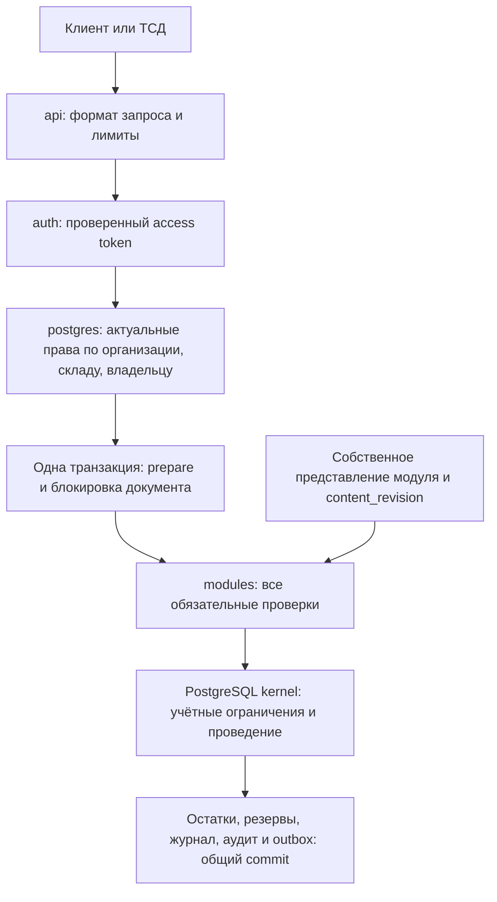

# Повторный аудит backend WMS — 27 октября 2026

Проверена реализация после `fa67634`: структура пакетов, HTTP/OIDC, доступ к БД, учётные SQL-команды, обязательные guards, установка модулей, конкурентные запросы и поведение при обрыве соединения. Найденные дефекты воспроизведены регрессиями, затем исправлены. Текущий контракт: ядро **0.3.0**, SDK **2.0.0**, пример dispatch-quality **1.1.0**.

Это проверка существующего складского ядра. Она не подтверждает готовность всей WMS к продаже или отсутствие любых будущих дефектов.

## Структура и границы ответственности

| Компонент | Ответственность | Граница |
|---|---|---|
| `cmd/wms-api` | Конфигурация, startup, пул, HTTP, остановка | Не создаёт схемы и не применяет миграции |
| `internal/api` | Маршруты, строгий JSON, точные количества, ошибки | Не принимает actor/права от клиента |
| `internal/auth` | Подпись, issuer, audience, срок и назначение токена | Права берутся из БД |
| `internal/inventory` | Типы команд, области доступа, разрешения | Не хранит остатки в памяти |
| `internal/postgres` | Параметризованный SQL, проверки доступа, транзакции и повторы | Runtime не владеет объектами ядра |
| `internal/modules` | Совместимость, зависимости, привязки guards и сведения об установке | Модуль не получает SQL-транзакцию через SDK |
| `internal/clientmodules` | Проверки конкретного клиента | Доверенный код в общем процессе |
| `db/migrations` | Устойчивые учётные правила и опубликованные представления | Развёрнутые миграции не редактируются |

## Исправленные дефекты

| Приоритет | Дефект и последствие | Исправление и регрессия |
|---|---|---|
| P1 | Манифест переносил `CheckApproval` с отгрузки на резервирование; отгрузка оставалась без обязательного guard | Код закрепляет точное множество handler/point; перенос, пропуск и лишняя привязка запрещены |
| P1 | HTTPS discovery/JWKS мог перенаправить загрузку ключей на HTTP; токен принимался по ключу из незащищённого ответа | Проверяется каждый редирект; разрешённые HTTPS-переходы и политика HTTP-клиента сохраняются |
| P2 | Runtime-проверка замечала запись только в `stock_balances`, пропуская другие таблицы, обновляемые views и отдельные колонки | Startup проверяет все объекты ядра, CREATE, административные flags и возможность `SET ROLE` |
| P2 | Потеря подтверждения `COMMIT` возвращала общий `500`, хотя данные уже были сохранены | `503` с повтором прежнего ID; тест реально отбрасывает серверный ответ и доказывает отсутствие двойного резерва |
| P2 | Существование projection считалось достаточной проверкой установки модуля | Сверяются схема, версия, точные ID/SHA256 миграций и доступность projection |
| P2 | Разные IDs модулей могли дать одну схему; длинные имена допускали обрезку PostgreSQL | Коллизии запрещены, длина проверяется до SQL |
| P2 | Причина из 2000 русских символов нарушала байтовый лимит, хотя соответствовала OpenAPI | Лимит считается по Unicode-символам; проверены ASCII, кириллица и emoji на границе 2000/2001 |
| P2 | Изоляция интеграционных тестов проверяла только первый адрес DSN | Проверяются все запасные адреса и одна локальная БД/порт для admin/runtime |
| P2 | `govulncheck` нашёл два доступных по графу вызовов дефекта `x/text` через pgx | `x/text` обновлён с 0.29.0 до 0.41.0, транзитивный `x/sync` — до 0.22.0; повторные сканирования Windows/Linux чистые |

Уязвимости зависимости: [GO-2026-6629](https://pkg.go.dev/vuln/GO-2026-6629) и [GO-2026-5970](https://pkg.go.dev/vuln/GO-2026-5970). Обнаружение по графу вызовов не означает доказанную эксплуатацию через HTTP API; исправление убирает известные уязвимые версии из используемой цепочки.

Сохранились прежние гарантии: атомарность остатков/резервов/журнала, десятичные количества, проверка версии документа, сериализация одинаковых command IDs, блокировки балансов по UUID и append-only история. Дополнены API-сценарии приёмки, переноса, корректировки, частичного отбора/отгрузки и попыток записи в чужую организацию/склад/владельца.

## Обновление ядра и модулей

SDK 2 — намеренное изменение контракта скомпилированного модуля. SDK 1 отклоняется явно. Одного переименования диапазона совместимости недостаточно: клиентский код должен объявить `GuardPoints`, а модуль с данными — `SchemaVersion` и SHA256 своих миграций. SQL-данные dispatch-quality версии 1.0 совместимы с 1.1; меняется комплектация и описание исполняемого контракта.

1. Собрать новый бинарник вместе с нужными клиентскими модулями и прогнать проверки на копии установки. Сохранить проверенный прежний комплект и выполнить резервное копирование с контролируемым восстановлением.
2. Остановить приём новых команд и завершить активные запросы старого процесса. Одновременная работа разных комплектов guards здесь не поддерживается.
3. Владелец схемы применяет только новую `0004_module_integrity.sql` и обновлённые backend grants. Старые `0001`–`0003` не переприменяются. Миграция расширяет views без переписывания учётных таблиц; ожидание DDL-блокировки ограничено.
4. Для существующего dispatch-quality выполнить `db/examples/upgrade_dispatch_quality_1_1.psql`. Скрипт проверяет прежнюю установку и историю миграций, затем меняет метаданные пакета. Для новой установки используется `enable_dispatch_quality.psql` после SQL пакета.
5. Запустить новый сервис с `WMS_REQUIRED_MODULES`, проверить readiness и ключевые операции. Не обходить ошибку совместимости удалением обязательного модуля или ручным ослаблением SDK range.

Это конкретный проверяемый путь для текущего образца. Универсальный менеджер миграций, установка произвольных клиентских пакетов и автоматический rollback пока не реализованы.

## Что проверено

- Сначала получены падающие регрессии; [red evidence](../verification/backend-audit-red.json) фиксирует исходные сбои.
- Полный [green report](../verification/backend-audit-green.json): `go vet`, `go test -race -tags=integration`, новый изолированный PostgreSQL 17.11, все критичные регрессии и 41 прежний SQL-сценарий.
- Проверены сборка сервера, OpenAPI 3.1, полный манифест, ресурсы пакета и контрольные суммы SQL.
- [Проверка зависимостей](../verification/backend-audit-security.json): `govulncheck` 1.9.0, конфигурации Windows/amd64 и Linux/amd64; после обновления известных уязвимостей не найдено. Проверена также сборка под Linux, без заявления о runtime-испытании Linux-установки.
- SQL-ядро просмотрено на порядок блокировок, точность количеств, границы организаций/складов/владельцев и соответствие учётному журналу.

Новый код не заменяет доказательства работоспособности конкретного развёртывания. Проверка истории миграций не обнаруживает любое ручное изменение SQL-объектов администратором. Скомпилированный модуль остаётся доверенным кодом; зависший обработчик нельзя принудительно остановить контекстом Go.

## Следующие условия коммерческой поставки

| Область | Необходимое подтверждение |
|---|---|
| Производительность | Репрезентативный объём остатков и истории, горячие SKU, конкурирующие ТСД, длительный прогон; p95/p99, планы запросов, блокировки и бюджет соединений |
| Восстановление | Фактический restore/PITR на отдельном стенде, проверка учёта после восстановления, измеренные RPO/RTO |
| Эксплуатация | Метрики команд/ошибок/ожиданий/пула, понятные оповещения, лимиты ingress, регламент установки, обновления и восстановления |
| Клиентский контур | Настоящий OIDC и отзыв доступа, TLS/сертификаты, разрыв сети ТСД, остановка и перезапуск сервиса |
| Прикладная полнота | API справочников/документов, ввод/отзыв согласований, управление evidence, outbox worker, обработка истёкших резервов и пользовательские сценарии |

Для SaaS и on-prem сохраняется одна бизнес-реализация и выделенная БД клиента. Различаются поставка, инфраструктурные средства и ответственность за восстановление; эти способы размещения ещё нужно испытать отдельно.
